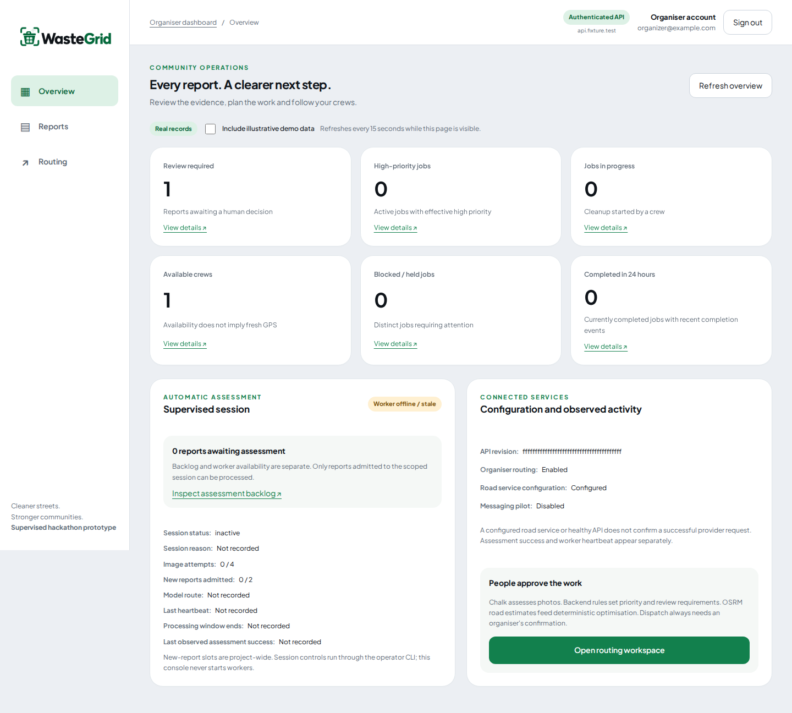

  

# WasteGrid

### Cleaner streets. Smarter coordination. A response people can follow.

**WasteGrid is an AI-assisted waste response platform that connects community
reports to coordinated cleanup operations.**

For local authorities, cleanup operators, and organizations responsible for shared
spaces, the challenge extends beyond collecting waste: knowing where to act,
what needs attention first, and how to put limited crews to work.

WasteGrid brings resident reporting, photo assessment, route planning, and
cleanup updates into one shared workflow. Its business goal is straightforward:
help organizations turn available people and equipment into a more responsive,
accountable cleanup service.

**Report → Prioritize → Coordinate → Collect → Close the loop**

*The organizer workspace with sample records.*

## The problem: a report needs a response

Imagine a resident spotting waste blocking a footpath. They can describe the
problem and share a photo, but someone still needs to establish the location,
judge its urgency, find a suitable crew, and fit the job into the day's work.
The resident then needs an answer about what happened.

Each handoff creates coordination work. A photo needs context. A list of reports
needs priorities. Available crews need feasible assignments. A completed task
needs to make its way back to the person who raised it.

WasteGrid connects those handoffs around the same report, giving the organization
a path from incoming demand to action and giving residents visibility afterward.

## What WasteGrid does

### Reporting that gives teams something to act on

Residents capture a photo, add context, and confirm a location on their phone.
Organizers receive an actionable case with evidence and a place to send a crew.
Saved submissions can be recovered when connectivity interrupts the process.

### Prioritization with human judgment

Photo analysis identifies visible conditions, and explicit rules translate those
observations into priority. Suspected hazards, uncertainty, and possible
duplicates are surfaced for review. Organizers keep control of the decisions
that commit people and resources.

### Dispatch built around available capacity

Organizers bring jobs and crews together in a routing workspace. Plans account
for road travel times, equipment, crew capacity, and work already underway.
They can inspect the proposed response, see work that does not fit, and approve
dispatch with a clear view of the tradeoffs.

### A visible path to completion

Crews receive ordered stops, start their assignments, and report completion,
optionally adding a cleanup photo. Residents can follow the original report's
progress and history. Consented iMessage status updates provide another way to
receive that information.

## Who it is built for

| Intended customer or user | Value WasteGrid is designed to offer |
| --- | --- |
| **Local authorities and sanitation teams** | A shared view of reported problems, priorities, assigned work, and unresolved demand. |
| **Cleanup operators and contractors** | A way to organize field crews around actual jobs, travel, equipment, and capacity. |
| **Campuses, housing communities, and facilities teams** | A reporting and response workflow for the shared spaces they manage. |
| **Community organizations** | A way to coordinate cleanup activity and keep participating residents informed. |
| **Residents** | A simple way to raise a concern and follow the response to it. |

The organization responsible for delivering the service is the prospective
customer. Residents and crews are the people whose participation makes that
service work.

## The business value

WasteGrid is designed to improve four parts of the operating model:

- **Less coordination overhead.** Photos, locations, review decisions, assignments,
  and updates stay connected, reducing the need to reconstruct a case across
  separate conversations and lists.
- **Better use of crew capacity.** Planning considers travel and resource needs
  before dispatch, helping organizations make deliberate choices about what
  their teams can complete.
- **Clearer service accountability.** A shared history makes it possible to follow
  a report through review, assignment, and crew-reported completion, including
  evidence when a photo is supplied.
- **A stronger resident feedback loop.** People can see progress after submitting,
  giving the organization a consistent way to communicate its response.

The commercial opportunity is to make coordination itself a useful service:
helping an organization direct its existing cleanup resources more effectively
while making its work visible to the community.

## Business model and path to adoption

A proposed **B2B/B2G subscription model** would charge the organization operating
the service while keeping resident reporting free. Plans could scale with the
number of active crews or the service areas managed. Future paid capabilities
could include multi-area reporting, service-level analytics, and integrations
with an organization's existing work-order systems.

An initial rollout could focus on one campus, managed community, or local
service area with a clear operational owner. The first goal would be to prove
value within that team's existing workflow before expanding to additional crews
or locations.

A rollout would measure time from report to resolution, travel time per completed
job, crew workload, and resident follow-up engagement. These are validation
targets for the business case, rather than claimed field results.

## Why this approach matters

**The full response stays connected.** Community reporting, operational planning,
crew execution, and resident communication share the same case.

**AI supports the people doing the work.** Photo understanding helps organize
incoming information; human review and dispatch approval remain central.

**The workflow accounts for field conditions.** Equipment requirements, road
travel, existing assignments, and recoverable submissions shape the response.

Together, these choices make WasteGrid a foundation for running a cleanup
service with a clearer connection between community needs and operational action.

## Technology with a purpose

**Expo and React Native** power the resident and crew app; **React and Leaflet**
power the organizer workspace. **FastAPI and Supabase** maintain shared reports,
private photos, roles, and job history. **Chalk Model Gateway** supports structured
photo understanding, **OSRM** supplies road travel times for the custom routing
heuristic, and **Photon** powers consented iMessage updates.

## Our vision

A resident should be able to point out a problem and follow a meaningful response.
A cleanup team should be able to turn that signal into a practical plan.

WasteGrid's ambition is to make that connection part of everyday community
infrastructure: cleaner shared spaces, better-coordinated field work, and a more
visible relationship between public concerns and the service delivered.

---

[Mobile app](mobile/README.md) · [Organizer workspace](web/README.md) ·
[Development guide](docs/development.md) · [Project documentation](docs/README.md)
