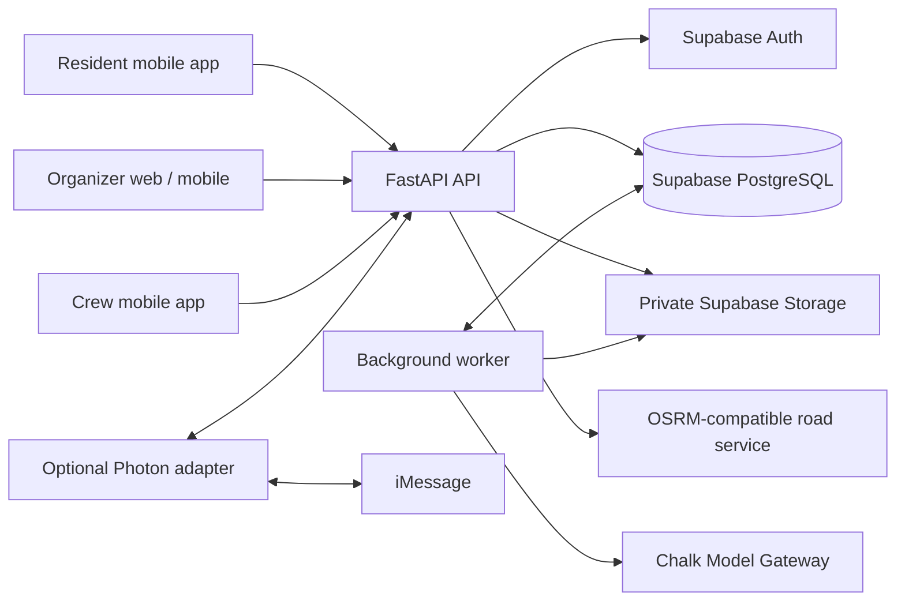

# WasteGrid development guide

Setup, architecture, configuration, verification, and deployment for developers. For the product story and demo experience, start with the [project README](../README.md).

## Architecture and stack



| Layer | Technology and purpose |
| --- | --- |
| Mobile | Expo SDK 58, React Native, TypeScript, Expo Router, native camera/location, and SecureStore. |
| Web | React, TypeScript, Vite, React Router, and Leaflet; live organizer console and Android app entry page. |
| API and persistence | Python, FastAPI, SQLAlchemy, PostgreSQL migrations, Supabase Auth, and private photo Storage. |
| Assessment | Chalk Model Gateway routes requests to the configured vision model; Python validates output and derives priority. |
| Routing | An OSRM-compatible driving-time matrix and a bounded heuristic with equipment, capacity, priority, and fixed-work constraints. |
| Messaging | Photon polling, backend delivery records, and a local SQLite ledger for transport recovery. |
| Deployment and checks | Docker, Render service definitions, pytest, Vitest, Playwright browser checks, Node tests, and GitHub Actions. |

## Repository structure

```text
WasteGrid/
├── api/                  # FastAPI, authorization, assessment, routing, worker
│   └── messaging/        # Photon adapter and delivery ledgers
├── mobile/               # Native resident, organizer, and crew app
├── web/                  # Organizer console and Android app entry page
├── brand/                # Shared WasteGrid logo and app icon assets
├── supabase/migrations/  # Ordered PostgreSQL schema migrations
├── scripts/              # Migrations, demo setup, contracts, and verification
├── tests/                # Python unit and backend integration tests
├── docs/                 # Demo guide, runbooks, contracts, and design history
├── Dockerfile            # API/worker image
├── render.dev.yaml       # API-only development service definition
├── render.organizer.yaml # Organizer static site definition
├── render.yaml           # Legacy API and background worker definition
└── routing_algo.md       # Detailed routing algorithm explanation
```

## Getting started

### Prerequisites

- **Node.js 22.22.2 or newer** and npm; CI uses Node 22.
- **Python 3.12 or 3.13** and **uv** for the backend. The Python manifest permits
  Python 3.11 through 3.14.
- A configured Supabase project and provisioned accounts, or access to the team's
  shared development API and public Supabase configuration.
- A native device or emulator with a compatible Expo runtime for the mobile
  workflow. Durable report and crew submissions require the native app.
- Docker with PostgreSQL 17 for backend integration tests.

Clone the repository and enter its root:

```bash
git clone https://github.com/hassanraza04/WasteGrid.git
cd WasteGrid
```

### 1. Choose your backend

The client examples point to the [shared development API](https://wastegrid-api-dev.onrender.com).
Its interactive contract is available at [API docs](https://wastegrid-api-dev.onrender.com/docs)
when the service is running. Obtain the matching Supabase publishable key and
provisioned demo account privately. A configured API URL does not establish that
assessment workers, road routing, or messaging are active.

To run your own backend, first follow [backend setup](backend/setup.md) to
configure Supabase, apply migrations, and provision staff. From the repository root:

```bash
uv sync --locked --extra backend --group dev
test -f .env || cp .env.example .env
# Fill in the backend values in .env, then apply migrations to your own project.
uv run --extra backend python -m scripts.migrate
uv run --extra backend uvicorn api.main:app --host 127.0.0.1 --port 8000 --no-access-log
```

The local API exposes `/health`, `/ready`, and `/docs`. `/ready` checks database
and Supabase configuration; it does not test model or road-provider credentials.
For a physical phone, bind the API to `0.0.0.0` and use this machine's reachable
LAN address in the mobile configuration. `127.0.0.1` on the phone is the phone itself.

For an independent development dataset, the general worker runs separately
after its server-side configuration is ready:

```bash
uv run --extra backend python -m api.worker
```

Starting it consumes eligible queued work and can call external providers. The
shared hackathon workflow uses a separately approved, bounded assessment session
with four image attempts; keep general workers stopped and follow the
[operator runbook](backend/organizer-prototype.md) and
[one-phone walkthrough](backend/hackathon-finish.md).

### 2. Run the organizer dashboard

From the repository root:

```bash
test -f .env.local || cp web/.env.example .env.local
# Set the three VITE_ values in the root .env.local.
cd web
npm ci
npm run dev -- --host 127.0.0.1
```

Open [the organizer dashboard](http://127.0.0.1:5173/admin). Sign in with a
provisioned organizer account. The API must allow this exact browser origin in
`CORS_ORIGINS`. Vite is configured with `envDir: ".."`, so it reads environment
files from the **repository root**. See [web setup](../web/README.md).

### 3. Run the mobile app

In a separate terminal, from the repository root:

```bash
cd mobile
test -f .env.local || cp .env.example .env.local
# Set the EXPO_PUBLIC_ values for the same backend and Supabase project.
npm ci
npm start
```

Open the app in a compatible native development build or Expo Go runtime.
Residents can submit anonymously; **My reports** requires sign-in and lists
reports saved for that account on the current device. Staff sign-in reveals
**Dispatch** for organizers or **My route** for crews. Accounts must already exist;
there is no in-app sign-up. See [mobile setup](../mobile/README.md) and the
[demo walkthrough](demo.md).

Restart both development servers after changing environment values.

## Configuration

| Component | Local file | Required configuration |
| --- | --- | --- |
| Backend | Root `.env`, copied from [`.env.example`](../.env.example) | `DATABASE_URL`, `SUPABASE_URL`, `SUPABASE_SECRET_KEY`, private bucket settings, integration secrets, and exact browser `CORS_ORIGINS`. |
| Web | Root `.env.local`, using [`web/.env.example`](../web/.env.example) | `VITE_API_BASE_URL`, `VITE_SUPABASE_URL`, `VITE_SUPABASE_PUBLISHABLE_KEY`. |
| Mobile | `mobile/.env.local`, using [`mobile/.env.example`](../mobile/.env.example) | `EXPO_PUBLIC_API_BASE_URL`, `EXPO_PUBLIC_SUPABASE_URL`, `EXPO_PUBLIC_SUPABASE_PUBLISHABLE_KEY`. |
| Assessment worker | Backend environment | `CHALK_ROUTER_API_KEY`, `CHALK_ENV_ID`, and a configured `CHALK_MODEL`. |
| Organizer routing | API and worker environment | `ORGANIZER_ROUTING_ENABLED=true` and a working `ROUTING_OSRM_BASE_URL`; clients require the matching routing contract. |
| Photon, optional | Adapter/backend environment | Photon credentials, matching messaging integration keys, backend URL, and approved scope. [Phone updates](backend/phone-updates.md) additionally require the confirmed peer and masked phone label; follow the [pilot runbook](backend/photon-chalk-pilot.md) before activation. |

Only public Supabase configuration belongs in `VITE_` or `EXPO_PUBLIC_` variables.
Keep database credentials, service-role keys, provider keys, account passwords,
and resident report tokens out of client configuration. Local environment files
and `.data/` are ignored by Git.

## Tests and quality checks

From the repository root, after installing each component's dependencies:

```bash
# Python: set TEST_DATABASE_URL to a disposable localhost PostgreSQL server first.
uv run --extra backend pytest -q
uv run --extra backend python -m scripts.export_contracts --check

# Web: tests with coverage, followed by TypeScript and production build.
(cd web && npm run coverage && npm run build)

# Mobile: behavior tests, TypeScript, lint, and the configured dependency audit.
(cd mobile && npm test && npx tsc --noEmit && npm run lint && npm run audit:ci)
```

Backend tests create and drop isolated databases. Without `TEST_DATABASE_URL`,
database-dependent tests are skipped. Use the disposable PostgreSQL commands in
[backend setup](backend/setup.md#5-reproducible-verification) to run them;
never point tests at the shared project. `bash scripts/verify_backend.sh` adds
formatting, contract checks, a Docker build, and HTTP smoke tests.

The [Quality workflow](../.github/workflows/quality.yml) runs Python, web, browser,
and mobile checks. For the fixture-backed responsive browser walkthrough, see
`npm run test:browser` in the [web guide](../web/README.md). [Repository safety](repository-safety.md) lists the complete checks
and existing dependency-audit exceptions. Provider doubles in automated tests do
not establish live Chalk, Photon, GPS, or device acceptance.

## Deployment

The backend ships as a Docker image. [`render.dev.yaml`](../render.dev.yaml) defines
the API-only development service; [`render.organizer.yaml`](../render.organizer.yaml)
defines the organizer static site with its SPA rewrite. The legacy
[`render.yaml`](../render.yaml) defines an API and general worker; use it only for
an independent deployment that needs that worker. Apply all migrations before
starting a new API revision. The development definition enables organizer routing
and disables messaging; confirm actual environment settings on the running services.

The web app builds with `npm run build` into `web/dist`; a static host must send
client-side routes such as `/admin/dispatch` to `index.html`. Mobile native builds
need the public environment for their target backend. Follow the
[backend deployment guide](backend/setup.md#4-render) and
[shared development runbook](backend/shared-development-api.md) for service setup.

## Current scope and limitations

- **Resident intake uses the native app.** The browser landing directs residents
  and crews to the Android demo; legacy `/report/*` links redirect there. Earlier
  browser-local prototype reports never entered the shared API.
- **Mobile statistics are hidden from live navigation.** Their source fixtures
  remain illustrative. The web overview reads operational backend counts rather
  than claiming measured impact. The public mobile map uses rounded coordinates
  for real reports and removes markers when linked work is completed.
- **Report access depends on the saved token.** Resident history is stored on
  the current device and is not synced across devices. A public reference alone
  cannot recover access if the token is lost.
- **Processing depends on running services.** New reports can remain pending
  while the worker is stopped. Routing requires a road service and fresh crew
  locations. Messaging requires a separately configured adapter and opt-in.
- **Routing is a bounded heuristic.** It does not guarantee a global optimum.
  Organizer route limits apply to remaining work, with no multi-day shift ledger;
  mobile route maps show stop order. The web map requests separate road geometry
  and labels unavailable paths without replacing committed travel estimates.
- **Review and completion retain their meaning.** Routing never clears review
  holds. Nearby originals and photos remain separate. Optional cleanup photos
  are private evidence, and completion remains crew-submitted with no general
  crew undo action.
- **Messaging is a supervised integration.** The pilot must pass its scope,
  revision, migration, and budget checks. Provider acceptance and confirmed
  delivery are separate outcomes.

## Further documentation

| Guide | Use it for |
| --- | --- |
| [Demo walkthrough](demo.md) / [One-phone finish](backend/hackathon-finish.md) | Resident-to-crew demonstration, recording guidance, and the supervised Android/browser sequence. |
| [Organizer operations](backend/organizer-prototype.md) / [Phone updates](backend/phone-updates.md) | Console indicators, bounded assessment, dispatch recovery, and in-app Status replies. |
| [Documentation index](README.md) | Finding current guides and distinguishing them from historical plans. |
| [Web app](../web/README.md) / [Mobile app](../mobile/README.md) | Component setup, routes, roles, troubleshooting, and checks. |
| [Backend overview](backend/README.md) / [Setup](backend/setup.md) | API responsibilities, Supabase, migrations, and workers. |
| [API contracts](backend/contracts.md) | Authorization, commands, schemas, and examples. |
| [Routing](backend/routing.md) / [Scope](backend/scoped-routing.md) / [Controls](backend/routing-controls.md) | Road-time previews, dispatch invariants, resource limits, and partial work. |
| [Assessment](backend/assessment.md) / [Messaging pilot](backend/photon-chalk-pilot.md) | Provider configuration, review behavior, and supervised messaging. |
| [Verification history](backend/verification.md) | Dated acceptance evidence and its limits. |
